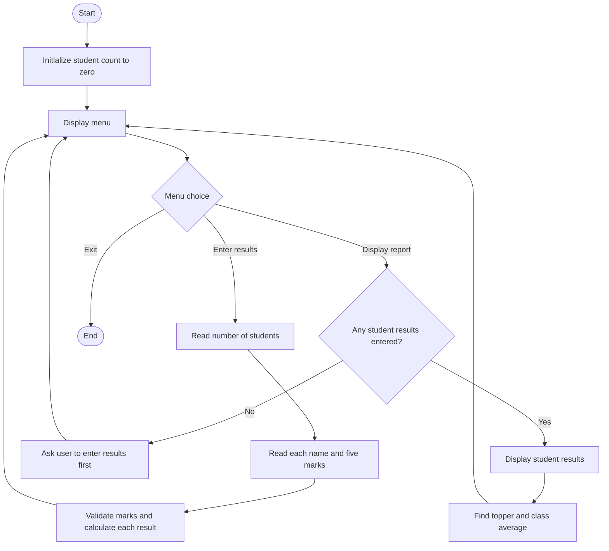

# Student Grade Analyzer

## Problem statement
Develop a result-processing program that calculates student performance across five subjects for multiple students. The program reports each student's total marks, percentage, grade, and pass/fail status. It also finds the class topper and calculates the class average.

## Team details
- Team number: Not assigned
- Batch: 35
- Team members: Swayam Asthana, Sahibpreet Singh, Kshitji Arora

## Objectives and features
- Enter results for 1 to 30 students across five subjects.
- Validate student count and subject marks. Marks must be whole numbers from 0 to 100.
- Calculate total marks out of 500 and percentage for each student.
- Assign a grade using the percentage bands below.
- Mark a student as passed only when every subject mark is at least 40.
- Display a class report, identify the topper, and calculate the class average.
- Use a menu to enter results, display the report, or exit.

### Grade bands
- A: 90% or above
- B: 80% to below 90%
- C: 70% to below 80%
- D: 60% to below 70%
- F: below 60%

## C concepts used
- **Structure (`struct Student`)** stores each student's name, five marks, total, percentage, grade, and pass/fail result together.
- **Arrays** store the five subject marks and the group of student records.
- **Variables and constants** store results and define limits such as `SUBJECTS` and `MAX_STUDENTS`.
- **Functions** split the program into input validation (`readInteger`), result calculation (`calculateResult`), student input (`enterStudents`), and reporting (`displayReport`).
- **Pointers** let `calculateResult` update a student record and let `enterStudents` return the number of entered students.
- **Loops** (`for`, `while`, and `do-while`) repeat input, calculations, validation, and the menu.
- **Conditional statements** (`if`, `else if`, and `else`) validate values, decide pass/fail, assign grades, and choose menu actions.
- **Formatted input and output** use `scanf` and `printf` to read data and display the report. `getchar` clears invalid extra input.
- **Arithmetic and type conversion** calculate totals and percentages.

## Algorithm
1. Initialize the student count to zero.
2. Display the menu: enter results, display report, or exit.
3. If the user chooses to enter results, ask for the number of students (1 to 30).
4. For each student, read the name and five marks. Validate each mark is between 0 and 100.
5. Add the marks. If any subject mark is below 40, mark the student as failed.
6. Calculate the percentage and assign a grade from the grade bands.
7. If the user requests the report, display every student's results, find the highest total, and calculate the class average percentage.
8. Return to the menu until the user chooses Exit.

## Flowchart


## Compile and run
With GCC:

```sh
gcc student_grade_analyzer.c -o student_grade_analyzer
./student_grade_analyzer
```

On Windows with GCC:

```sh
gcc student_grade_analyzer.c -o student_grade_analyzer.exe
student_grade_analyzer.exe
```

## Sample test case
Enter two students using menu option 1, then choose option 2 to display the report.

| Student | Subject marks | Total | Percentage | Grade | Status |
|---|---|---:|---:|---|---|
| Asha | 90, 80, 70, 60, 100 | 400/500 | 80.00% | B | PASS |
| Ravi | 40, 40, 40, 40, 39 | 199/500 | 39.80% | F | FAIL |

Expected class topper: Asha. Expected class average: 59.90%.

### Actual output
```text
STUDENT RESULT REPORT
---------------------------------------------------------------
Name                 Total   Percent   Grade   Status
---------------------------------------------------------------
Asha                 400/500    80.00%     B     PASS
Ravi                 199/500    39.80%     F     FAIL
---------------------------------------------------------------
Class topper: Asha (400/500, 80.00%)
Class average: 59.90%
Pass rule: at least 40 marks in every subject.
Grade rule: A >= 90, B >= 80, C >= 70, D >= 60, otherwise F.
```

## Notes
The program compiled and produced the sample output above with GCC. Confirm the grade bands with your faculty if different rules were specified. The hackathon guidelines also require a presentation for the Lab 2 demonstration.

